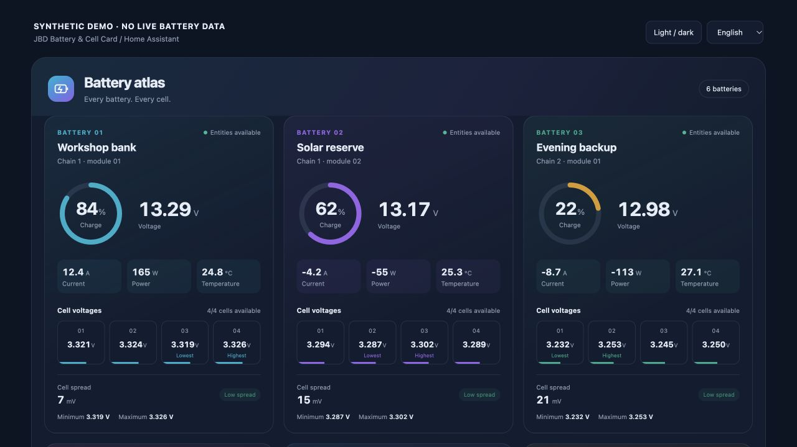

# JBD Battery & Cell Card

A colorful, read-only Home Assistant card for battery packs and **every individual cell**. Charge rings, pack voltage, current, power, temperature, cell bars, and min/max/spread — in one responsive view.

Works with entities from [ESPHome JBD BMS MQTT](https://github.com/victron-venus/esphome-jbd-bms-mqtt), native ESPHome, or another integration exposing numeric battery sensors. **Victron, Cerbo GX, Venus OS, and `dbus-mqtt-battery` are not required.**

- Multiple batteries and chains, with explicit entity mapping; no guessed IDs.
- Individual cell voltages in V or mV, normalized to volts; 1–64 cells per battery.
- Home Assistant light/dark themes, mobile layout, and 24 languages selected automatically from the HA profile, with per-card overrides and English fallback.
- Unknown or unavailable measurements stay missing; no invented zeroes or aggregate SOC.
- Tap or keyboard-activate a value to open HA's more-info dialog. No device commands.
- One dependency-free JavaScript module; no CDN, tracking, external requests, or build needed for installation.

[Configuration and data semantics](docs/configuration.md) · [Languages and auto-detection](docs/i18n.md) · [ESPHome deployment without Victron](docs/esphome-deployment.md) · [HACS installation and publication](docs/hacs.md) · [Echo Dot Bluetooth assessment](docs/echo-dot-bluetooth.md)

**User guides:** [English](docs/translations/README.en.md) · [العربية](docs/translations/README.ar.md) · [বাংলা](docs/translations/README.bn.md) · [Čeština](docs/translations/README.cs.md) · [Deutsch](docs/translations/README.de.md) · [Español](docs/translations/README.es.md) · [فارسی](docs/translations/README.fa.md) · [Français](docs/translations/README.fr.md) · [עברית](docs/translations/README.he.md) · [हिन्दी](docs/translations/README.hi.md) · [Bahasa Indonesia](docs/translations/README.id.md) · [Italiano](docs/translations/README.it.md) · [日本語](docs/translations/README.ja.md) · [한국어](docs/translations/README.ko.md) · [Nederlands](docs/translations/README.nl.md) · [Polski](docs/translations/README.pl.md) · [Português](docs/translations/README.pt.md) · [Русский](docs/translations/README.ru.md) · [ไทย](docs/translations/README.th.md) · [Türkçe](docs/translations/README.tr.md) · [Українська](docs/translations/README.uk.md) · [Tiếng Việt](docs/translations/README.vi.md) · [简体中文](docs/translations/README.zh-Hans.md) · [繁體中文](docs/translations/README.zh-Hant.md).

The [24 translated guides](docs/translations/README.md) cover installation, configuration, language selection, ESPHome deployment and measurement quality. Detailed technical references use English. The 24-language interface requires **0.2.0 or newer**; development documentation can describe code newer than the latest [published release](https://github.com/ha-homelab/ha-jbd-bms-card/releases).

## Preview



The screenshot uses invented demo values, not live battery data. [Light theme preview](docs/images/synthetic-demo-light.png).

Run `python3 -m http.server 8124` from this repository and open [the synthetic demo](http://localhost:8124/demo/). The demo includes low-charge, high-spread, and missing-cell fixtures. It is clearly marked as invented data and does not connect to Home Assistant.

## Install

### HACS custom repository

In HACS, open **Custom repositories**, add `https://github.com/ha-homelab/ha-jbd-bms-card` with category **Dashboard**, and download the card. This is a custom repository, not a claim of inclusion in the default HACS store.

If HACS does not register the resource automatically, add a **JavaScript module** resource:

```text
/hacsfiles/ha-jbd-bms-card/ha-jbd-bms-card.js
```

### Manual

Copy `ha-jbd-bms-card.js` into `/config/www/`. In **Settings → Dashboards → Resources**, add a JavaScript module:

```text
/local/ha-jbd-bms-card.js?v=0.1.0
```

The Resources page may require Advanced Mode in your HA user profile. Reload the browser after adding the resource. Adding or updating a dashboard resource does not require a Home Assistant restart when `/config/www` already exists. If you create `www` for the first time, restart Home Assistant once so `/local/` is served.

Download the JavaScript from the intended published release and use that version in the cache-busting query above. If moving from a manual installation to HACS, follow the [migration steps](docs/hacs.md#move-from-a-manual-installation-to-hacs) and keep only one registered resource for this card.

## Add a card

Edit a dashboard, choose **Manual**, and use the configuration below. Replace **every entity ID** with the actual ID from **Developer Tools → States**. These are illustrative names, not a promise about ESPHome discovery IDs.

```yaml
type: custom:ha-jbd-bms-card
title: Battery room
language: auto
batteries:
  - name: Battery 1
    subtitle: Chain 1 · 4S LiFePO₄
    soc: sensor.my_battery_soc
    voltage: sensor.my_battery_voltage
    current: sensor.my_battery_current
    power: sensor.my_battery_power
    temperature: sensor.my_battery_temperature
    cells:
      - sensor.my_battery_cell_1
      - sensor.my_battery_cell_2
      - sensor.my_battery_cell_3
      - sensor.my_battery_cell_4
```

Add more entries under `batteries` for the second chain or further batteries. The card automatically arranges them into columns according to the available width. For eight packs, a full-width **Panel** view is useful; the card also supports Sections and Masonry views. Card configuration uses YAML; the card picker supplies a placeholder configuration that must be edited.

Only `soc`, `voltage`, and a nonempty `cells` list are required per battery. Current, power and temperature are optional. Cell names, availability gating and display thresholds are documented in [configuration](docs/configuration.md).

Omit `language` or use `auto` to follow the HA profile. Use `language: en` to keep this card in English, or any supported language code for a fixed override. Regional tags are recognized; unsupported languages fall back to English. Names supplied in YAML stay exactly as written. Arabic, Persian and Hebrew use right-to-left layout. All translations are bundled in the same JavaScript file; see [language selection and contributions](docs/i18n.md).

## Connect the battery sensors

Deploy the [ESPHome JBD BMS MQTT firmware](https://github.com/victron-venus/esphome-jbd-bms-mqtt), connect its MQTT broker to HA, and select the resulting entities. The firmware also exposes sensors through its encrypted native ESPHome API. The maintained profiles each collect four BMS with four cells per BMS; changing that topology needs firmware work even though the card supports other cell counts. Follow the [deployment guide](docs/esphome-deployment.md) and upstream [standalone Home Assistant guide](https://github.com/victron-venus/esphome-jbd-bms-mqtt/blob/main/docs/standalone-home-assistant.md) for credentials, provisioning and sensor mapping. Installing the card alone does not create battery entities or flash hardware.

## What the colors mean

Default display ranges suit a **4S LiFePO₄ example**, not every installation: cells 2.8–3.65 V; spread warning at 30 mV and high spread at 80 mV; SOC low at 15% and warning at 30%. These are visualization thresholds, **not BMS protection settings or advice to change them**. Set them for your chemistry and operating range. The card never changes a battery, charger, inverter, or BMS setting.

Cell bars use the configured voltage range and are not estimates of cell SOC. Spread is calculated only when **all configured cells** have valid readings. Its color says nothing about simultaneity or balancing activity.

## Data and freshness

“Entities available” means the configured numeric HA states are present. It does **not** mean the BMS has just been sampled. MQTT retained state can survive a producer disconnect, and stable HA values may retain old `last_changed`/`last_updated` timestamps while the physical sensor continues reporting. The card does not use those timestamps to invent a freshness guarantee.

An optional `availability` entity can hide all values for a pack when a trustworthy upstream per-battery availability signal is not online. An ESP32 MQTT birth/LWT status alone only establishes transport connectivity. For strict freshness, validate the producer's atomic telemetry and expiration upstream, then expose unavailable HA entities or a per-battery availability sensor. See the upstream [telemetry contract](https://github.com/victron-venus/esphome-jbd-bms-mqtt/blob/main/docs/battery-telemetry.md).

## Development

Node.js 22 or newer:

```bash
npm ci --ignore-scripts
npm run check
npm run check:docs
npm run check:ci
npm test
npm run build
node scripts/check-package.mjs
```

`build` verifies the version and copies the root module to `dist/`; the root module is the distributable. Tests exercise numeric validity, availability, complete-cell spread, safe rendering, keyboard navigation and focus, entity update filtering, localization, and multiple batteries. Documentation checks verify local links and coverage of every supported language. The GitHub Actions required check is **CI gate**, including official HACS validation and the [five-target browser/OS baseline](docs/browser-compatibility.md). See [releasing](RELEASING.md) before tagging or publishing.

Validated in Home Assistant **2026.10.0** with eight batteries and 32 cells, desktop and a 320 px mobile viewport, including more-info interaction. The screenshot above remains synthetic.

Built against the [Home Assistant custom card API](https://contributors.home-assistant.io/frontend/custom-ui/card/). No custom HA integration or backend is needed. License: [MIT](LICENSE).
