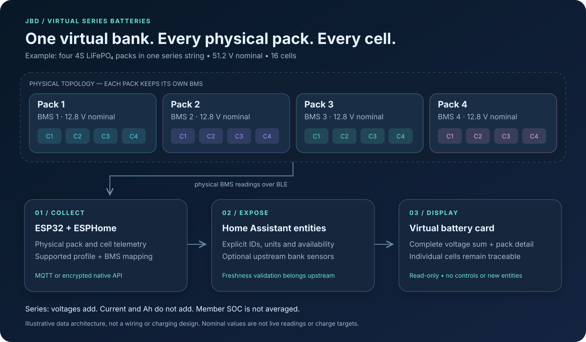
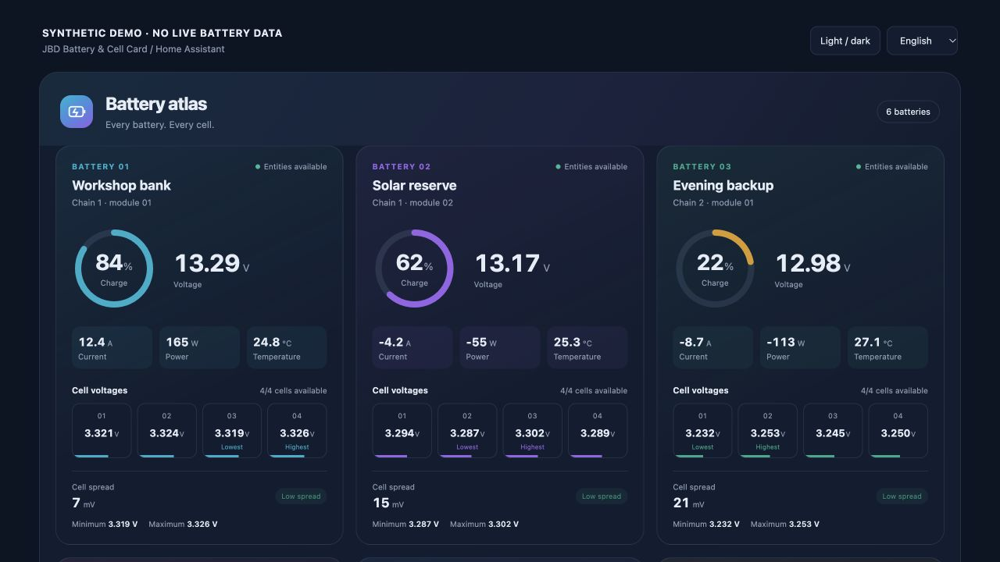

# JBD Battery & Cell Card

A colorful, read-only Home Assistant card for **virtual series batteries, their physical packs, and every individual cell**. One bank summary keeps the voltage total and source measurements above the pack-level charge rings, cell bars, and min/max/spread.

Works with entities from [ESPHome JBD BMS MQTT](https://github.com/victron-venus/esphome-jbd-bms-mqtt), native ESPHome, or another integration exposing numeric battery sensors. **Victron, Cerbo GX, Venus OS, and `dbus-mqtt-battery` are not required.**

- One, two, three, four or more physical packs per virtual series battery; multiple independent strings in one view.
- Complete member-voltage sums, explicit upstream current/SOC, nominal-voltage labels and configurable display ranges. Series current and Ah are never added; member SOC is never averaged.
- Backward-compatible flat pack layout, with explicit entity mapping; no guessed IDs.
- Individual cell voltages in V or mV, normalized to volts; 1–64 cells per battery.
- Home Assistant light/dark themes, mobile layout, and 24 languages selected automatically from the HA profile, with per-card overrides and English fallback.
- Unknown or unavailable measurements stay missing; no invented zeroes or aggregate SOC.
- Tap or keyboard-activate a value to open HA's more-info dialog. No device commands.
- One dependency-free JavaScript module; no CDN, tracking, external requests, or build needed for installation.

[Virtual batteries and series math](docs/virtual-batteries.md) · [Configuration and data semantics](docs/configuration.md) · [Examples](examples/README.md) · [Runbook](docs/runbook.md) · [Troubleshooting](docs/troubleshooting.md) · [Languages and auto-detection](docs/i18n.md) · [ESPHome deployment without Victron](docs/esphome-deployment.md) · [HACS installation and publication](docs/hacs.md) · [Echo Dot Bluetooth assessment](docs/echo-dot-bluetooth.md)

**User guides:** [English](docs/translations/README.en.md) · [العربية](docs/translations/README.ar.md) · [বাংলা](docs/translations/README.bn.md) · [Čeština](docs/translations/README.cs.md) · [Deutsch](docs/translations/README.de.md) · [Español](docs/translations/README.es.md) · [فارسی](docs/translations/README.fa.md) · [Français](docs/translations/README.fr.md) · [עברית](docs/translations/README.he.md) · [हिन्दी](docs/translations/README.hi.md) · [Bahasa Indonesia](docs/translations/README.id.md) · [Italiano](docs/translations/README.it.md) · [日本語](docs/translations/README.ja.md) · [한국어](docs/translations/README.ko.md) · [Nederlands](docs/translations/README.nl.md) · [Polski](docs/translations/README.pl.md) · [Português](docs/translations/README.pt.md) · [Русский](docs/translations/README.ru.md) · [ไทย](docs/translations/README.th.md) · [Türkçe](docs/translations/README.tr.md) · [Українська](docs/translations/README.uk.md) · [Tiếng Việt](docs/translations/README.vi.md) · [简体中文](docs/translations/README.zh-Hans.md) · [繁體中文](docs/translations/README.zh-Hant.md).

The [24 translated guides](docs/translations/README.md) cover installation, configuration, language selection, ESPHome deployment and measurement quality. Detailed technical references use English. The 24-language interface requires **0.2.0 or newer**; development documentation can describe code newer than the latest [published release](https://github.com/ha-homelab/ha-jbd-bms-card/releases).

**Version note:** virtual series grouping starts with **0.3.0-beta.1**. Select this prerelease or a later release that includes `virtual_batteries`; 0.2.0-beta.1 only supports flat packs. See [release notes](https://github.com/ha-homelab/ha-jbd-bms-card/releases) and [HACS prerelease installation](docs/hacs.md#install-a-prerelease).

## Preview



Four 4S LiFePO₄ packs make a **51.2 V nominal** virtual series battery (48 V class); one, two and three make 12.8, 25.6 and 38.4 V nominal. These are illustrative nominal values, not charge targets or a wiring plan. See [series math and limits](docs/virtual-batteries.md).

The original flat layout remains available:




The screenshot uses invented demo values, not live battery data. [Light theme preview](docs/images/synthetic-demo-light.png).

Run `python3 -m http.server 8124` from this repository and open [the synthetic demo](http://localhost:8124/demo/). The demo has selectable one/two/three/four/five-pack series, two independent strings, other cell counts/chemistries, upstream sensors, missing data and legacy flat-layout fixtures. [Visual previews and scenario URLs](docs/screenshots.md) describe reproducible captures. It is clearly marked as invented data and does not connect to Home Assistant.

## Install

### HACS custom repository

In HACS, open **Custom repositories**, add `https://github.com/ha-homelab/ha-jbd-bms-card` with category **Dashboard**, and download the card. This is a custom repository, not a claim of inclusion in the default HACS store.

If HACS does not register the resource automatically, add a **JavaScript module** resource:

```text
/hacsfiles/ha-jbd-bms-card/ha-jbd-bms-card.js
```

### Manual

Copy `ha-jbd-bms-card.js` into `/config/www/`. In **Settings → Dashboards → Resources**, add a JavaScript module:

```text
/local/ha-jbd-bms-card.js?v=0.1.0
```

The Resources page may require Advanced Mode in your HA user profile. Reload the browser after adding the resource. Adding or updating a dashboard resource does not require a Home Assistant restart when `/config/www` already exists. If you create `www` for the first time, restart Home Assistant once so `/local/` is served.

Download the JavaScript from the intended published release and use that version in the cache-busting query above. If moving from a manual installation to HACS, follow the [migration steps](docs/hacs.md#move-from-a-manual-installation-to-hacs) and keep only one registered resource for this card.

## Add a card

Edit a dashboard, choose **Manual**, and replace every example entity ID with its actual value from **Developer Tools → States**. The example below groups two physical 4S packs into one 25.6 V nominal virtual battery (24 V class). It does not create new HA sensors or control a battery.

```yaml
type: custom:ha-jbd-bms-card
title: Battery room
language: auto
virtual_batteries:
  - name: Reserve bank
    nominal_voltage: 25.6
    batteries:
      - name: Physical pack 1
        nominal_voltage: 12.8
        soc: sensor.my_bms_1_soc
        voltage: sensor.my_bms_1_voltage
        cells:
          - sensor.my_bms_1_cell_1
          - sensor.my_bms_1_cell_2
          - sensor.my_bms_1_cell_3
          - sensor.my_bms_1_cell_4
      - name: Physical pack 2
        nominal_voltage: 12.8
        soc: sensor.my_bms_2_soc
        voltage: sensor.my_bms_2_voltage
        cells:
          - sensor.my_bms_2_cell_1
          - sensor.my_bms_2_cell_2
          - sensor.my_bms_2_cell_3
          - sensor.my_bms_2_cell_4
```

The summary sums all valid member voltages. It needs explicit group `current` and `soc` entities to show those bank values; it does not sum currents or invent a virtual SOC. Optional upstream bank voltage/power and per-pack current/power/temperature are supported. See [configuration and inheritance](docs/configuration.md), [four-pack 51.2 V example](examples/series-4-pack.yaml), [two independent strings](examples/two-independent-strings.yaml), and the full [example catalog](examples/README.md).

Existing configurations with top-level `batteries` continue to show the original flat layout. Use exactly one of top-level `batteries` and `virtual_batteries`. Moving an existing physical pack entry under a group's `batteries` preserves its entity IDs and settings. The card accepts 1–32 groups, 1–32 packs per group and 1–64 cells per pack; these are frontend limits, not hardware ratings or ESP32 BLE connection guarantees.

For several strings, a full-width **Panel** view is useful. Sections and Masonry views also work. Card configuration uses YAML; the picker supplies a placeholder that must be edited. Follow the [runbook](docs/runbook.md) for inventory, acceptance, updates and rollback.

Omit `language` or use `auto` to follow the HA profile. Use `language: en` to keep the card in English, or another supported language code for a fixed override. Regional tags are recognized; unsupported languages fall back to English. YAML names stay exactly as written. Arabic, Persian and Hebrew use right-to-left layout. See [language selection](docs/i18n.md).

## Connect the battery sensors

Deploy the [ESPHome JBD BMS MQTT firmware](https://github.com/victron-venus/esphome-jbd-bms-mqtt), connect its MQTT broker to HA, and select the resulting entities. The firmware also exposes sensors through its encrypted native ESPHome API. The two maintained production profiles each collect four BMS with four cells per BMS. The card can display other topologies, but frontend support alone does not change collector/firmware capabilities; consult the firmware documentation for supported generated profiles and their telemetry compatibility. Follow the [deployment guide](docs/esphome-deployment.md) and upstream [standalone Home Assistant guide](https://github.com/victron-venus/esphome-jbd-bms-mqtt/blob/main/docs/standalone-home-assistant.md) for credentials, provisioning and sensor mapping. Installing the card alone does not create battery entities or flash hardware.

## What the colors mean

Default display ranges suit a **4S LiFePO₄ example**, not every installation: cells 2.8–3.65 V; spread warning at 30 mV and high spread at 80 mV; SOC low at 15% and warning at 30%. These are visualization thresholds, **not BMS protection settings or advice to change them**. Set them for your chemistry and operating range. The card never changes a battery, charger, inverter, or BMS setting.

Cell bars use the configured voltage range and are not estimates of cell SOC. Spread is calculated only when **all configured cells** have valid readings. Its color says nothing about simultaneity or balancing activity.

## Data and freshness

“Entities available” means the configured numeric HA states are present. It does **not** mean the BMS has just been sampled. MQTT retained state can survive a producer disconnect, and stable HA values may retain old `last_changed`/`last_updated` timestamps while the physical sensor continues reporting. The card does not use those timestamps to invent a freshness guarantee.

An optional `availability` entity can hide all values for a pack when a trustworthy upstream per-battery availability signal is not online. An ESP32 MQTT birth/LWT status alone only establishes transport connectivity. For strict freshness, validate the producer's atomic telemetry and expiration upstream, then expose unavailable HA entities or a per-battery availability sensor. See the upstream [telemetry contract](https://github.com/victron-venus/esphome-jbd-bms-mqtt/blob/main/docs/battery-telemetry.md).

## Development

Node.js 22 or newer:

```bash
npm ci --ignore-scripts
npm run check
npm run check:docs
npm run check:ci
npm test
npm run build
node scripts/check-package.mjs
```

`build` verifies the version and copies the root module to `dist/`; the root module is the distributable. Tests exercise numeric validity, availability, complete-cell spread, safe rendering, keyboard navigation and focus, entity update filtering, localization, and multiple batteries. Documentation checks verify local links and coverage of every supported language. The GitHub Actions required check is **CI gate**, including official HACS validation and the [five-target browser/OS baseline](docs/browser-compatibility.md). See [releasing](RELEASING.md) before tagging or publishing.

The previous flat layout was validated in Home Assistant **2026.10.0** with eight batteries and 32 cells, desktop and a 320 px mobile viewport, including more-info interaction. See [visual previews](docs/screenshots.md) for clearly labelled synthetic fixtures; release validation should record the exact card version and topology.

Built against the [Home Assistant custom card API](https://contributors.home-assistant.io/frontend/custom-ui/card/). No custom HA integration or backend is needed. License: [MIT](LICENSE).
