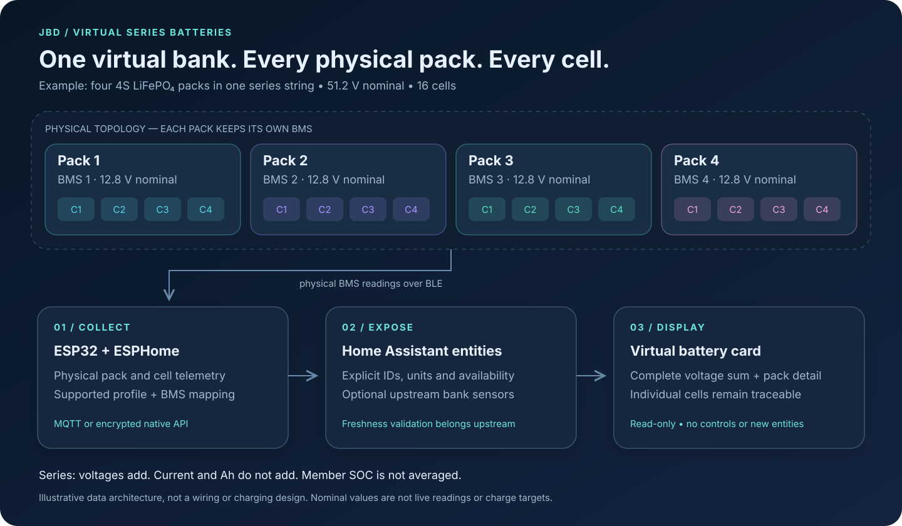
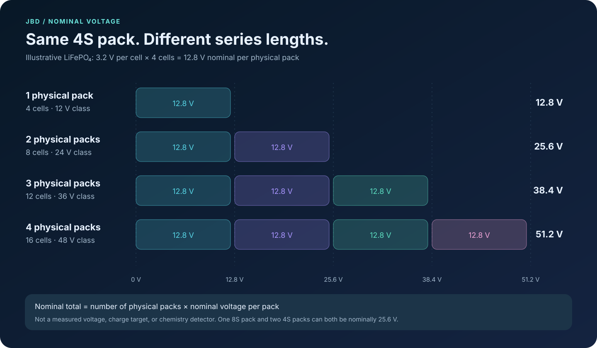
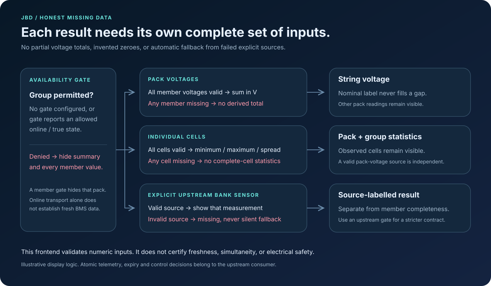
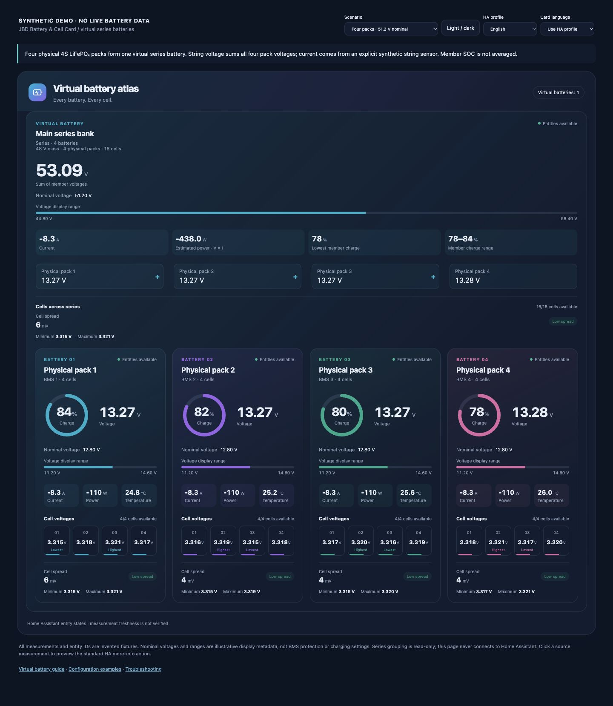
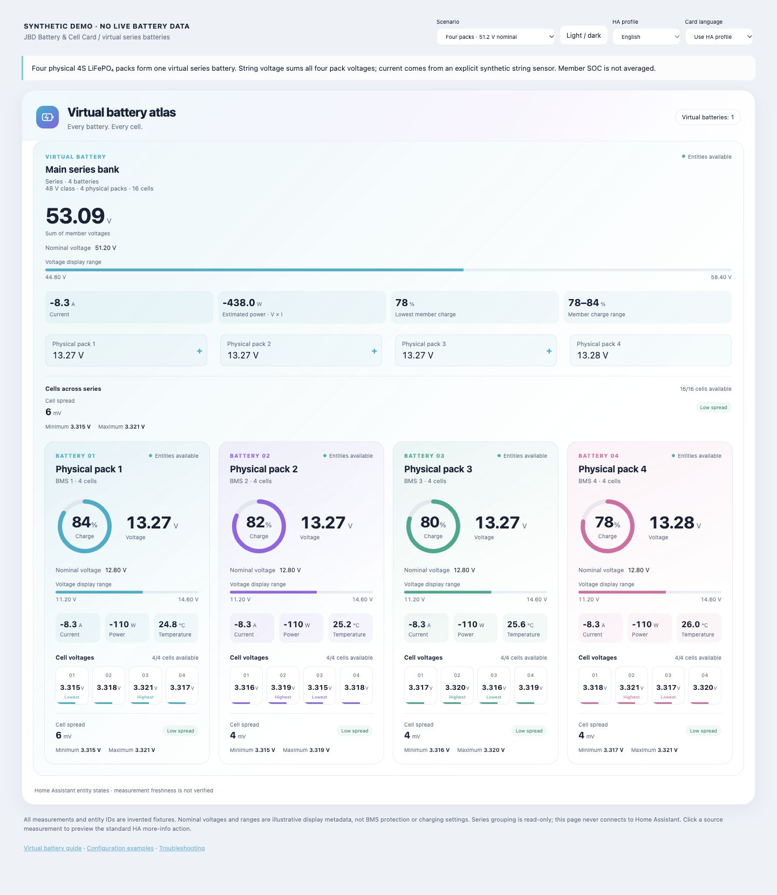
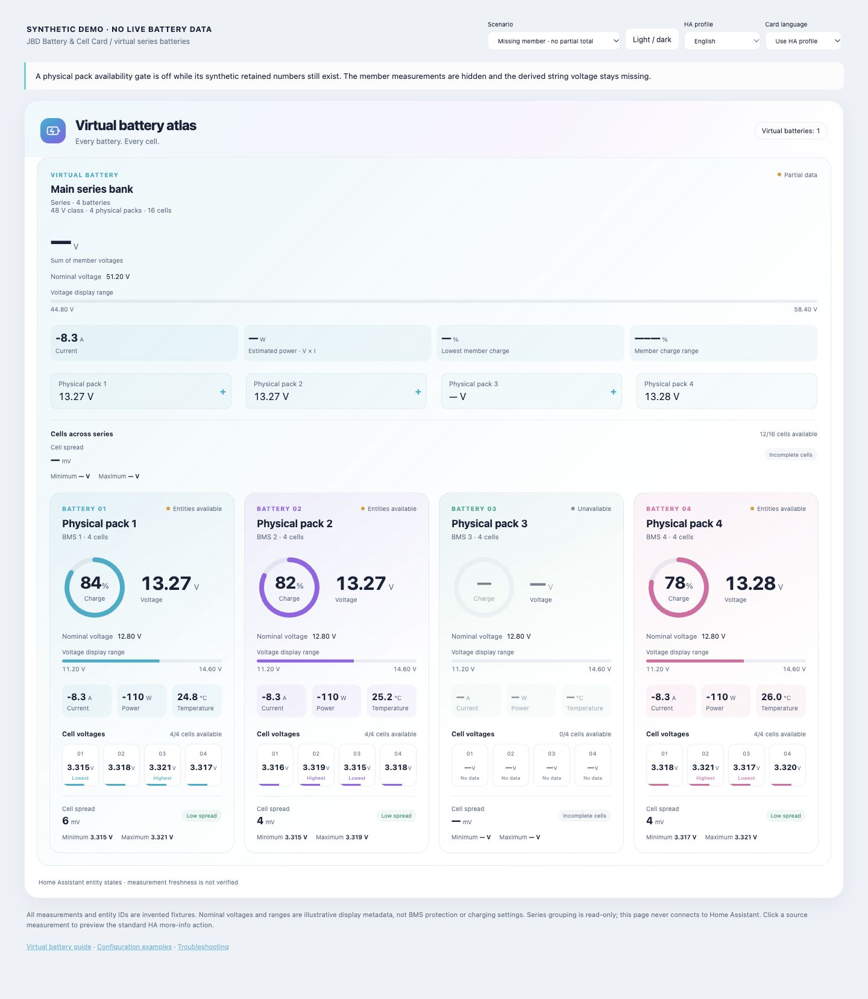
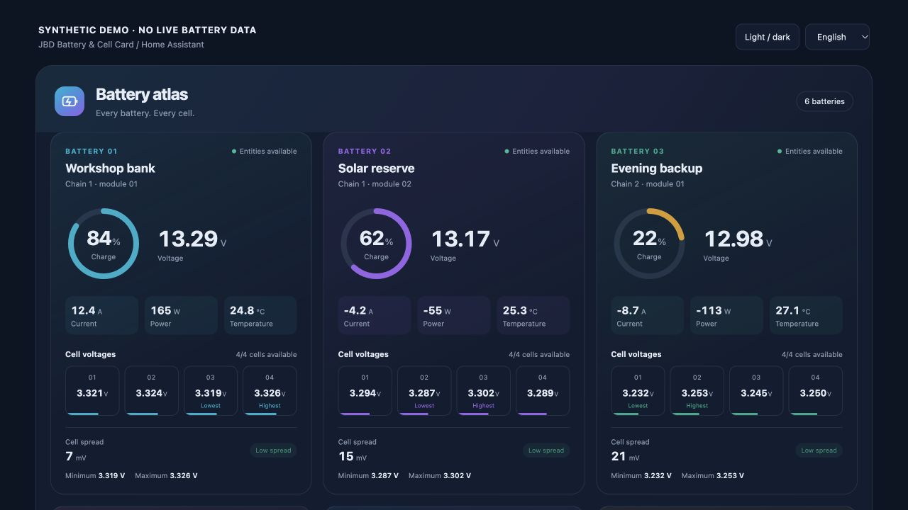
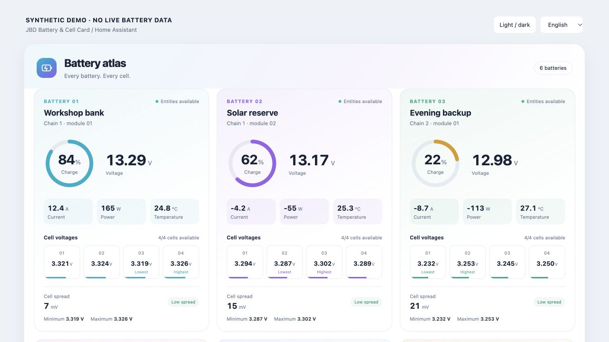

# Visual previews and reproducible screenshots

The public demo contains **invented readings and synthetic entity IDs**. It does not connect to Home Assistant. Every capture from it must retain the synthetic-data label. Diagrams show data grouping and display rules, not a wiring or charging design.

## Architecture and charts







The SVG source files are scalable, accessible text-based assets. Nominal-voltage examples use 3.2 V per LiFePO₄ cell and 12.8 V per 4S pack. The 12/24/36/48 V class labels are deliberately distinct from 12.8/25.6/38.4/51.2 V nominal values.

## Current virtual-series screenshots

Captured in a real browser with synthetic fixtures. These screenshots show frontend rendering, not live battery readings or hardware commissioning.







[Arabic RTL mobile screenshot, 390 px viewport](images/virtual-series-arabic-mobile.jpg) demonstrates a narrow layout and automatic profile-language selection.

The desktop fixtures use `series-4` (dark/light) and `missing-pack`; the mobile fixture uses `series-4` with Arabic. Captured from the virtual-series development source. Published release validation should identify the final release/commit separately.

## Capture the current virtual-series demo

From the repository root, run `python3 -m http.server 8124`, then open `http://localhost:8124/demo/` in a browser. The default scenario is one four-pack virtual battery. Select a scenario, theme and simulated HA language using the visible controls. Source measurements dispatch a synthetic more-info event; no network request is made to an HA instance.

Useful direct URLs are:

```text
http://localhost:8124/demo/?scenario=series-4
http://localhost:8124/demo/?scenario=series-4&theme=light
http://localhost:8124/demo/?scenario=series-1
http://localhost:8124/demo/?scenario=series-2
http://localhost:8124/demo/?scenario=series-3
http://localhost:8124/demo/?scenario=series-5
http://localhost:8124/demo/?scenario=two-strings
http://localhost:8124/demo/?scenario=other-cells
http://localhost:8124/demo/?scenario=missing-cell
http://localhost:8124/demo/?scenario=missing-pack
http://localhost:8124/demo/?scenario=upstream-invalid
http://localhost:8124/demo/?scenario=group-offline
http://localhost:8124/demo/?scenario=upstream
http://localhost:8124/demo/?scenario=series-4&lang=ar
http://localhost:8124/demo/?scenario=legacy
```

The five-pack scenario demonstrates frontend configuration freedom, not five-BMS support in the maintained ESP32 profiles. The alternate-chemistry scenario uses separate groups. Missing-cell and missing-pack scenarios intentionally have different effects: cell statistics require all cells, while derived string voltage requires all pack-voltage sources.

Use a desktop viewport of at least 1280 px to show the summary and pack grid, plus a 320–390 px phone-width capture for responsive behavior. Capture a complete logical section rather than clipping missing-data indicators. Record the source commit/release, scenario, theme, viewport and browser. Do not describe a demo screenshot as live telemetry or hardware validation.

## Legacy flat-layout previews

These earlier screenshots demonstrate the original supported flat battery view. They are not evidence of virtual-group rendering:





For live Home Assistant captures, remove private addresses, tokens, device identifiers and unrelated household data before publishing, and state the actual topology. A live screenshot demonstrates rendering at that moment; it does not establish data freshness, control correctness or hardware commissioning.
