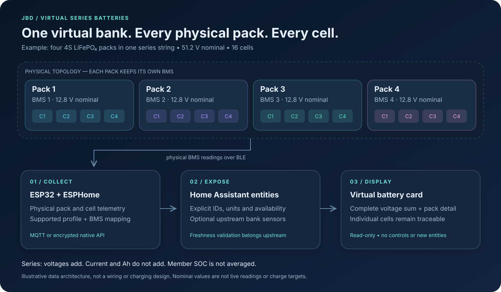
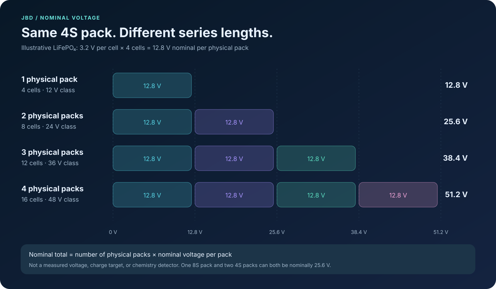
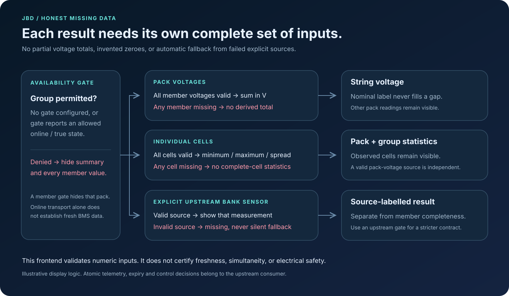

# Virtual batteries: physical packs in series

A **virtual battery** is the dashboard representation of one series string of physical battery packs. Each physical pack keeps its own BMS, pack measurements and individual cells. The card shows a string summary above those packs, so a 48 V-class bank does not lose the detail of its four 12 V-class members.

This feature is in development; use a release that explicitly includes `virtual_batteries`. The published 0.2.0-beta.1 does not include it. Existing flat `batteries` configurations remain supported.

The diagram describes data flow and grouping. It is **not a wiring plan**, a charging specification, or approval to connect particular batteries in series. Confirm series compatibility and electrical limits with the battery/BMS manufacturer. Configuring a group changes only this card's display.

## Three different counts

- **Cells per physical pack:** the cells managed by one BMS; for example, a 4S LiFePO₄ pack has four cells in series.
- **Physical packs per virtual battery:** the packs belonging to one series string; for example, four 4S packs make a 16-cell string.
- **Independent virtual batteries:** separate strings displayed on the same card. Merely listing two strings does not declare or control a parallel electrical connection.

The card accepts 1–32 virtual groups, each with 1–32 physical packs, and 1–64 cells per pack. Those are frontend configuration limits, **not ESP32 BLE connection limits or permitted electrical designs**. Only series grouping is implemented (`topology: series` is optional); parallel or mixed series/parallel aggregation is not implemented. A single physical pack is a valid group. Every configured pack remains visible even if another pack stops reporting.

## 12 / 24 / 36 / 48 V classes

For the illustrative LiFePO₄ case, each cell has a nominal voltage of 3.2 V and each physical 4S pack is nominally 12.8 V. One, two, three and four such packs therefore have nominal string voltages of **12.8, 25.6, 38.4 and 51.2 V**. The familiar 12, 24, 36 and 48 V names are voltage classes, not exact nominal measurements or charge targets.

`nominal_voltage` is a label in volts. It is never used to replace a missing measurement. `voltage_range: {min: ..., max: ...}` sets a display range; it is never a charger/BMS setting. Pack and group ranges are independent: set each explicitly when you want a voltage-range indicator.

Other cell counts and chemistries are supported by the card's explicit sensor mapping and configurable ranges. For example, a single 8S LiFePO₄ pack is nominally 25.6 V and two 4S packs have the same nominal total, but their physical/BMS layout is different. A single 7S pack using a manufacturer-stated 3.6 V nominal cell would be 25.2 V. Use the actual manufacturer's nominal value and operating limits; the card does not infer chemistry from the voltage or label. The [examples](../examples/README.md) keep these layouts separate.

## What the summary means

**Voltage:** without a group `voltage` entity, the card sums all member pack voltages after normalizing V/mV. Every member must be available and valid. If one is missing, the derived string voltage is missing. An optional explicit group `voltage` uses that upstream sensor instead; if it is invalid, the card does not silently substitute a calculated sum.

**Current:** series current is common to the string. Adding four readings of 10 A would not make 40 A. The card only shows group current when you explicitly select a group `current` entity. Choose a trusted string shunt or a deliberately selected BMS current source upstream; different sensor offsets/sign conventions must not be silently averaged. Member current readings remain visible for comparison.

**Power:** an explicit group `power` entity has priority. If no power entity is configured, valid group voltage and an explicitly mapped group current allow a clearly labelled V × I estimate. Independently updated HA states are not an atomic power measurement. An unavailable explicit power sensor remains unavailable.

**State of charge:** group SOC is shown only from an explicit group `soc` entity. Member percentages are never averaged into a virtual SOC. A separately labelled lowest-member SOC and member SOC range can be displayed when every member SOC is valid; these are diagnostics, not a bank SOC algorithm. SOC does not follow a linear conversion from cell voltage.

**Capacity:** current and amp-hours are not additive in series. The card does not calculate virtual Ah capacity, usable energy, or a new charge/discharge limit. For compatible equal-capacity packs, series increases nominal voltage while the Ah rating stays the same; an actual string's usable capacity depends on its limiting member and operating conditions. Capacity and control belong upstream. The series voltage/capacity relationship is also described in Victron’s [battery-bank wiring reference](https://www.victronenergy.com/media/pg/The_Wiring_Unlimited_book/en/battery-bank-wiring.html).

**Cells:** each cell remains attached to its physical pack. Group minimum/maximum/spread require every configured cell across the group; pack statistics independently require every cell in that pack. A group spread compares observed cells across packs and is not evidence that sampling was simultaneous or balancing is active.

## Missing data stays visible

A missing cell invalidates cell statistics, but a separately valid pack-voltage sensor can still contribute to string voltage. A missing member pack voltage prevents the derived string total; other physical packs remain visible. Missing optional temperature does not invalidate a valid voltage sum. An explicit upstream group measurement can remain available while member diagnostics are incomplete; it is labelled as a source measurement, not claimed to prove complete telemetry.

An optional group `availability` gate hides both its summary and all of its member measurements when it denies access. A member gate hides that member and invalidates aggregates that depend on it. A gate is only as reliable as its upstream logic. MQTT birth/LWT reports transport availability; retained values, an online ESP32, and HA timestamps do not independently establish a fresh, complete BMS sample.

## From ESP32 telemetry to a dashboard

The ESPHome project collects physical BMS samples. A control consumer may assemble those samples into one virtual battery for Victron or another system, using atomic telemetry, sequence/boot identity, validity and expiry. The frontend card instead consumes Home Assistant entities and displays a read-only grouping. **Adding `virtual_batteries` does not create a Home Assistant entity, a Venus OS D-Bus battery, or control-ready telemetry.**

Use the [firmware deployment guide](esphome-deployment.md) to get physical entities into HA. Use the upstream [telemetry contract](https://github.com/victron-venus/esphome-jbd-bms-mqtt/blob/main/docs/battery-telemetry.md) for control consumers. HA alone needs neither a Cerbo GX nor Victron software. If an upstream integration already provides trusted virtual-bank voltage/current/SOC, map those explicit entities into the summary and retain physical packs underneath.

## Choose a configuration

Start with the [annotated configuration reference](configuration.md) and [ready-to-edit examples](../examples/README.md). The examples cover one through four 4S packs, two independent strings, other cell counts/chemistries, and explicit upstream bank measurements. Every entity ID is a placeholder.

For first setup, updates, outages and rollback, follow the [operations runbook](runbook.md). For unexpected totals, blank fields, duplicate entities or loading issues, see [troubleshooting](troubleshooting.md). Screenshots and reproducible fixture scenarios are documented in [visual previews](screenshots.md).
